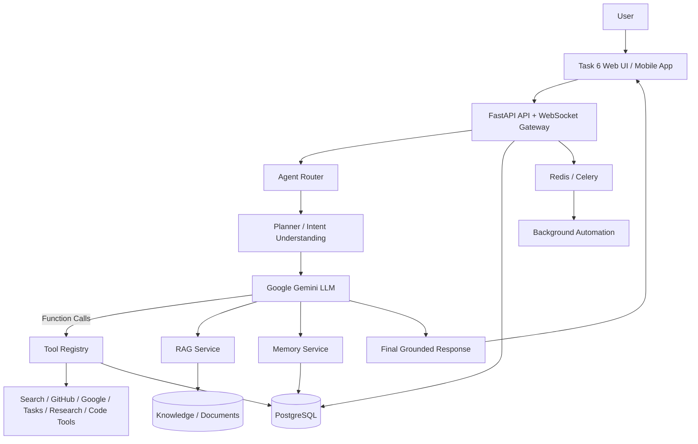

# Task 6 Architecture — VoxMate GenAI Capstone

## Agent lifecycle

**Understand → Plan → Select Tool → Validate/Authorize → Execute → Observe Result → Update State/Memory → Respond**.

The production Gemini path and the deterministic Task 5 runtime both make the agent lifecycle observable and testable.

## Task 6 demonstration path

1. Open the web UI.
2. Enter a normal question to demonstrate Gemini generation.
3. Ask a knowledge question to demonstrate RAG.
4. Ask for a calculation or another tool-supported action to demonstrate function/tool calling.
5. Show the execution metadata and explain the agent plan.
6. Open `/docs` to demonstrate the FastAPI API surface.
7. Show the repository documentation and deployment files.
